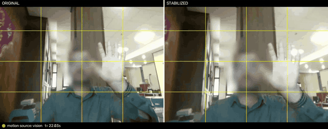
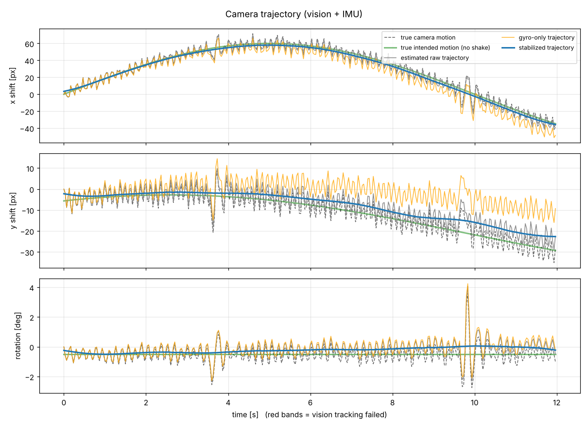
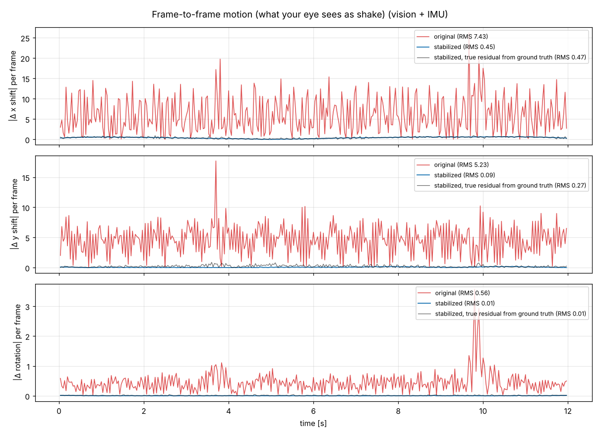
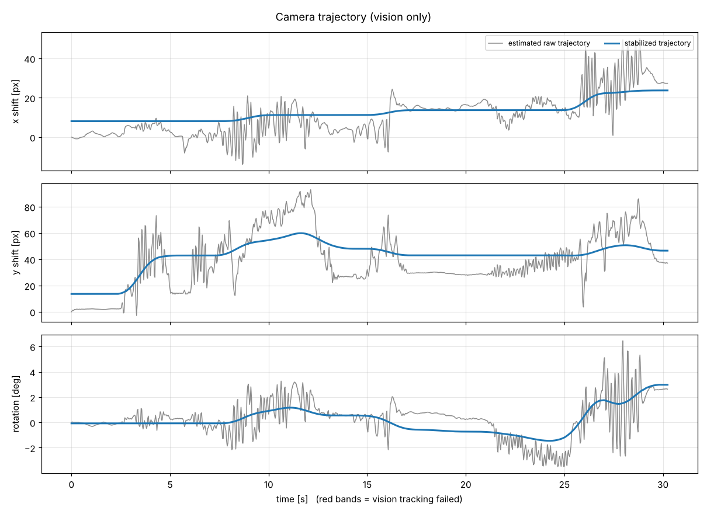
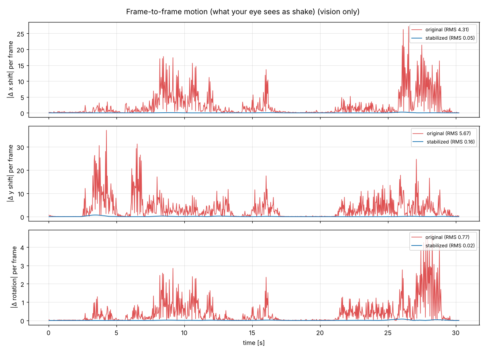

# camstab: software video stabilizer for cameras on vibrating systems

A lightweight Python + OpenCV video stabilizer for cameras mounted on machines, vehicles or gimbals that vibrate or get hit. It runs on a PC or on small ARM boards (Rockchip RK3576, Raspberry Pi, Jetson). It works on recorded video (offline) and on a live camera feed. Gyroscope (IMU) data can optionally be fused in.



*Left: original footage from a shaking camera. Right: stabilized with `--mode lock`. The yellow grid is fixed to the frame, which makes the shake easy to see. ([full video](docs/media/demo_full.mp4))*

## Features

- **Two stabilization styles**
  - `smooth`: follows a smoothed version of the camera path, so intended pans are kept.
  - `lock`: tripod-like. The view stays still while the camera wobbles inside a dead-zone, and smoothly follows when the camera is really re-aimed.
- **Offline and live modes.** Live mode has an adjustable delay, from 0 up to `--lookahead` frames.
- **Optional IMU fusion.** Gyro data takes over when the image is too blurred to track, for example during a sudden hit. It reads from a serial port or a CSV log, with axis-mapping and sign checks built in.
- **Works on low-contrast video.** A CLAHE contrast boost before feature detection makes IR and thermal footage trackable.
- **Measurable.** Every run writes a side-by-side video, trajectory and jitter plots, and a per-frame CSV.
- **Synthetic test generator.** Makes a shaky video with a matching gyro log and the exact true motion, so results can be checked against ground truth.

## How it works

```
 frame k-1 ─┐
            ├─► 1. track feature points (CLAHE → Shi-Tomasi corners → pyramidal Lucas-Kanade)
 frame k  ──┘
                2. robust rigid fit (RANSAC) → camera motion (dx, dy, rotation)
                        │          ▲
                        │   (optional) gyro rates integrated between frame timestamps
                        ▼
                3. trajectory = running sum of motions
                   target path = low-pass filtered trajectory   (smooth mode)
                               = dead-zone "hold" + smoothing    (lock mode)
                        │
                4. warp frame k by (target − raw), with a fixed zoom to hide the borders
```

Shake is the fast part of the camera path, and intended motion is the slow part. Smoothing keeps the slow part and removes the fast part. Offline mode can use past and future frames (a symmetric Gaussian filter). Live mode only knows `--lookahead` future frames, and uses a local linear fit so the view doesn't lag behind during pans.

## Results

### Synthetic test, checked against ground truth

`make_test_video.py` generates a 640×480 clip with a slow pan, 6–15 Hz vibration, random jitter and sudden hits with motion blur. Because the true motion is known, the remaining shake can be measured exactly.

| Test | Original shake | After stabilization |
|---|---|---|
| Default clip (vibration + 3 hits), vision only | 6.4 px/frame | **0.43 px/frame** (≈15× less) |
| Default clip, vision + simulated gyro | 6.4 px/frame | 0.39 px/frame |
| Hard clip (4 strong hits), vision only | 10.1 px/frame | 1.14 px/frame |
| Hard clip, vision + simulated gyro | 10.1 px/frame | **0.91 px/frame** |

*Remaining shake is the RMS frame-to-frame motion of the output, computed from the ground truth, not from the stabilizer's own estimate.*



**Trajectory plot.** The estimated raw path (grey) lies on top of the true camera motion (dashed), so the motion estimation is accurate. The stabilized path (blue) follows the true intended pan (green) and drops the vibration. The gyro-only path (orange) slowly drifts away because of gyro bias. That's why the gyro is fused with vision instead of being used alone.



**Jitter plot.** This shows the per-frame motion, which is what the eye sees as shake. Red is the original and blue is the stabilized output. The black line is the true remaining shake measured from the ground truth, and it stays near zero except for short spikes during the hits.

### Real footage (640×480, 30 fps, hand-shaken camera)

A 30-second indoor clip with bursts of shaking (around 3–7 s, 8–13 s, 16 s and 21–29 s), calm periods in between, and a person moving and waving in the foreground.

```bash
python stabilize.py offline raw.mp4 --mode lock --deadzone 30,30,2 --zoom auto --max-zoom 1.3
```



**Trajectory plot.** The grey line is the estimated camera path, with fast shaking of up to about ±20–30 px and ±3° on top of slow drift. In lock mode the stabilized path (blue) stays flat through the shaking bursts and only moves slowly where the camera's average position really changes, for example around 25–28 s. The frequency content is mixed: in x, about 30% of the motion energy is fast vibration (4–8 Hz), and in y most of it is slow sway below 1 Hz. Tracking never failed on this clip, so there are no red bands.



**Jitter plot.** This shows per-frame motion, which is what the eye sees as shake. The original (red) reaches 20–37 px per frame during the bursts. The blue curve is the *planned* output motion from the stabilizer's own estimate, and it stays near zero.

**Independent check.** The stabilized video was re-tracked as if it were a new input, using only the central 60% of the image so borders don't affect the result. This measures what actually reached the output:

| | Frame-to-frame motion | Shake above 0.5 Hz |
|---|---|---|
| Original | 4.9 px | 6.2 px |
| `smooth` mode (default) | 0.67 px | 1.46 px |
| `lock` mode (command above) | **0.66 px** | **1.12 px** |

That's about **7× less** frame-to-frame motion and about **5.5× less** shake. All values are in original-image pixels, RMS. `--zoom auto` chose a zoom of 1.17, which hides black borders in 98% of frames. The default fixed zoom of 1.08 would show some border in about 9% of frames.

**What remains:** a small residual from motion blur during the hardest shakes, and from the person moving in the foreground. RANSAC keeps the motion estimate locked to the background, but some tracked points still land on the person.

## Install

```bash
git clone https://github.com/<your-username>/camstab.git
cd camstab
pip install -r requirements.txt
```

- **Jetson:** use JetPack's OpenCV, which has GStreamer for CSI cameras, instead of the `opencv-python` wheel.
- **Raspberry Pi / Rockchip boards:** `sudo apt install python3-opencv python3-matplotlib python3-numpy`. The distro OpenCV usually includes GStreamer, which MIPI-CSI cameras need. A USB webcam works with either.

## Usage

### Try it without hardware

```bash
python make_test_video.py                     # -> test_data/shaky.mp4, imu.csv, ground_truth.csv
python stabilize.py offline test_data/shaky.mp4 --ground-truth test_data/ground_truth.csv
python stabilize.py offline test_data/shaky.mp4 --imu csv:test_data/imu.csv --ground-truth test_data/ground_truth.csv
```

Outputs go to `output/`: `comparison.mp4`, `stabilized.mp4`, `trajectory.png`, `jitter.png`, `trajectory.csv`.

### Live camera

```bash
python stabilize.py live --source 0 --save                     # USB webcam
python stabilize.py live --source csi-jetson --save            # Jetson CSI camera
python stabilize.py live --source libcamera --save             # Raspberry Pi camera
python stabilize.py live --source "v4l2src device=/dev/video11 ! video/x-raw,format=NV12,width=1280,height=720,framerate=30/1 ! videoconvert ! video/x-raw,format=BGR ! appsink drop=1"   # any GStreamer pipeline
python stabilize.py live --source 0 --record raw.mp4 --no-display   # headless, keep the raw video
```

Press `q` or Ctrl+C to stop; plots are saved on exit. Recording with `--record` and then running `offline` on the file gives the best result to compare against.

### Maximum damping (lock mode)

```bash
python stabilize.py offline raw.mp4 --mode lock --deadzone 60,60,3 --zoom auto --max-zoom 1.4
```

- `--deadzone x_px,y_px,deg`: how much wobble is absorbed before the view follows. Bigger = stiller, but needs more crop.
- `--zoom auto` (offline only) picks the smallest zoom that hides black borders in `--auto-zoom-pct` (98% by default) of frames.
- `--start` / `--end` (seconds) skip unusable parts of a recording.

### IMU (gyroscope)

The microcontroller prints one line per sample over serial: `gx,gy,gz`.

```bash
python stabilize.py live --source 0 --imu serial:/dev/ttyUSB0@115200 --imu-units deg --hfov 62
```

- `--hfov` (camera horizontal field of view) converts gyro angles to pixels.
- `--imu-axes` maps sensor axes to camera pitch, yaw and roll, e.g. `--imu-axes=-y,x,z`. Use `=` when the value starts with `-`.
- At the end of a run, the program prints the vision-vs-gyro correlation per axis. Each should be close to +1. A negative value means that axis needs its sign flipped.
- `--imu csv:log.csv` replays a log with columns `t,gx,gy,gz`, where `t` is seconds from the start of the video.

### Main options

| Option | Default | Effect |
|---|---|---|
| `--mode` | `smooth` | `smooth` follows a smoothed path; `lock` holds the view still |
| `--radius` | 30 | smoothing radius in frames; larger = smoother, more crop |
| `--lookahead` | 10 | live only: future frames used = output delay; 0 = no delay |
| `--zoom` | 1.08 | fixed zoom to hide borders; `auto` offline |
| `--max-shift`, `--max-angle` | 0.12, 6° | cap on the correction |
| `--process-width` | 480 | tracking resolution; lower = faster |
| `--keyframe` | off | track against a reference frame: less drift, noisier during hits |
| `--no-enhance` | off | disable the CLAHE contrast boost |

Run `python stabilize.py offline -h` or `live -h` for everything.

## Project layout

| File | Role |
|---|---|
| `stabilize.py` | command-line program (offline + live) |
| `motion.py` | feature tracking and robust rigid motion fit |
| `smoothing.py` | Gaussian, live fixed-lag and lock (dead-zone) smoothing |
| `imu.py` | IMU sources (CSV, serial), axis mapping, vision–gyro fusion |
| `visualize.py` | side-by-side frames and plots |
| `make_test_video.py` | synthetic shaky video + gyro log + ground truth |

## Limitations

- **2D motion model** (shift + rotation). It can't correct perspective changes from large tilts, parallax between near and far objects, or rolling-shutter "jello".
- **Motion blur** stays in the frames. Stabilization moves pixels; it can't sharpen them.
- **Stillness costs field of view.** Cancelling large motion needs a large crop.
- **For a tracking or gimbal-control loop**, use the measured camera motion (from `motion.py`), not the warped frames. The stabilized frame is shifted by the correction and delayed by the smoothing, so object positions in it don't match where the camera really points.

## License

MIT. See [LICENSE](LICENSE).
